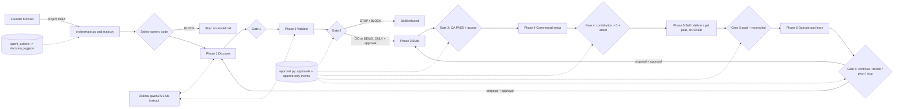

# FounderOS architecture

## Overview

FounderOS is a local-first venture system. One FastAPI process (`backend/app`) serves a vanilla-JS interface and an HTTP
API, stores everything in one SQLite file, and calls a small open-weight model through Ollama on the same machine. It
takes a founder's idea through six phases. Each phase ends in a gate that code evaluates, and moving on needs a founder
approval that the server checks.

Three rules hold everywhere:

- **Code decides gates; the model only drafts.** Model output is parsed against Pydantic schemas and treated as
  untrusted text. Verdicts, thresholds, money and state transitions are computed in Python.
- **Approvals are enforced on the server.** An approval is bound to a hash of the exact state it approved. It is single
  use and expires. It is refused if it was rejected, is still pending, or has gone stale because its inputs changed.
- **Phases 3-6 are MOCKED / TEST MODE.** The website is a DEMO-ONLY prototype with demo data. Payments go through a
  built-in signed simulator. Nothing is published, sent, spent, signed or deployed. No code for those actions exists.

## Phases

Each phase lists its inputs, its agents (one file per role, prompts in `prompts/`), its outputs and its gate.

### Phase 1: Discover

- **Inputs:** the founder's idea plus optional fields (problem, customer, market, current workaround, skills, budget, values).
- **Agents:** `safety` (12 code rules, runs first, so a blocked idea never reaches the model), Brief Refiner (model), Discovery agent (model, with a guard that removes claims not grounded in the brief), and the criterion judges.
- **Outputs:** a versioned brief with source spans per field, a safety screen, and a discovery report of hypotheses and unknowns.
- **Gate:** D09 is computed in code. Founder decision: approve for research only, revise, pivot or stop.

### Phase 2: Validate

- **Inputs:** the approved discovery report, the evidence ledger (sources that were fetched, with verified excerpts) and demand tests the founder pre-registers.
- **Agents:** research gatherer and verifier (code), Experiment Designer (code checks), Validation agent (model; it explains but does not decide) and a skeptic pass.
- **Outputs:** a validation report and a verdict computed in code: NEEDS_EVIDENCE, CONTINUE_TESTING, PIVOT, STOP_DO_NOT_LAUNCH or BLOCK.
- **Founder strategy** (`founder_strategy.py`, `decision.next_decision_card`). This is how the next step adapts to the founder:
  1. The risk register ranks the critical claims (problem, demand, switching, feasibility, price) by criticality, then by evidence strength: untested, background only, stated only, then observed behaviour.
  2. The weakest critical claim becomes the next test.
  3. Each claim has several candidate methods. For example, demand has a concierge test, a self-built page, a neutral opt-in, and a paid-ad smoke test. Each method carries an ASSUMED cost, duration, skills needed and evidence strength.
  4. Methods the founder cannot afford, cannot build, or cannot finish in their stated time are rejected, with the reason recorded.
  5. The strongest remaining method wins. Ties go to no spend, then wider reach, then a shorter run.
- **The Decision Passport's "Your next decision".** It states the decision and why, with evidence IDs, the claims still unknown, the rejected options and the trade-off. It also gives the founder-fit reasons, the next action, the cost and time (ASSUMPTION), a success criterion (a starting assumption the founder locks), and what would change the decision. Confidence describes evidence coverage of the critical claims, never a probability. It is NOT_APPLICABLE when a safety hard stop decided.
- **Research plan.** It is built from the brief's own fields and ranked by the same register, so the weakest critical claim is researched first. Each bucket says what research cannot prove; for example, market size is not demand.
- **Gate:** Gate 2 has three outcomes.
  - STOP or BLOCK refuses any build, including a demo.
  - GO allows an MVP build, but only when every critical locked test is a hit.
  - Anything else gives DEMO_ONLY.

### Phase 3: Build

- **Inputs:** the gate 2 payload (bound into the approval).
- **Agents:**
  - `agents/product_architect.py` writes the spec, features, user stories and acceptance criteria, using the founder's own words only. The prototype type is chosen from those words, and each type has its own data and working interactions:
    - **directory:** search, filters and details;
    - **forecast:** a usage log and a moving-average forecast;
    - **practice:** a quiz with a score;
    - **study planner:** tasks, hours and a 7-day schedule;
    - **client and project tracker:** clients, projects, tasks, % done, late and at-risk flags, and a per-client summary;
    - **appointment booking:** free and taken slots, a validated booking, a confirmation that sends nothing, and cancelling, which frees the slot.
  - `agents/website_builder.py` writes `index.html`, `styles.css`, `app.js` and `README.txt` with escaped demo data.
  - `agents/qa.py` runs static checks: structure, required ids, no `eval`/`fetch`/storage/`innerHTML`, and the demo label.
  - `agents/revision.py` parses feedback commands. Anything it does not understand is reported as NOT APPLIED.
- **Outputs:** versioned builds, a sandboxed preview, a ZIP export and version history.
- **Gate:** gate 3 needs QA PASS on the latest version plus founder approval `accept_build`.

### Phase 4: Commercial setup

- **Inputs:** price, costs, fees, sales scenarios and churn, all labelled ASSUMPTION.
- **Agents:** `agents/commercial.py`. It computes unit economics in `Decimal`: fee, contribution, margin, break-even, low/base/high scenarios, months to recover the build cost, and lifetime contribution. It also produces pricing hypotheses at 0.5x, 1x and 2x, business-model options, packages and a terms checklist.
- **Commercial decision** (`commercial.decide`). It turns the numbers into a recommendation with the arithmetic shown:
  - a loss per sale, with the minimum price that covers fees and variable cost;
  - break-even above the base or every scenario;
  - one-off plus 3 months of fixed costs above the founder's stated budget (currencies are never converted);
  - churn sensitivity for subscriptions;
  - a price with no recorded evidence, which leads to "collect price evidence".

  It never promises profit.
- **Outputs:** a versioned commercial plan. The payment provider status is always `MOCKED`.
- **Gate:** gate 4 gives STOP if every sale loses money. Otherwise it needs founder approval `activate_commercial` (TEST MODE only).

### Phase 5: Sell, deliver, get paid

- **Inputs:** the adopted plan and accepted build.
- **Agents:**
  - `agents/sales_delivery.py` drafts the offer and sales page. A honesty check bans fake reviews, urgency and income claims.
  - `payments.py` and `webhooks.py` run the signed TEST MODE simulator.
  - `delivery.py` handles access links, `refunds.py` handles refunds and `reconcile.py` handles reconciliation.
- **Outputs:**
  - orders, payment events, entitlements and refunds;
  - reconciliation records;
  - `outputs/payment_test_log.md` from the demo run.
- **Gate:** gate 5 needs four things:
  - an approved page draft (`approve_sales_page`);
  - an open test checkout (`open_test_checkout`);
  - at least one paid order;
  - a clean reconciliation.

### Phase 6: Operate and learn

- **Inputs:** recorded events, plus metrics and feedback the founder labels MANUAL or MOCK_DEMO (feedback carries its provenance), and issues.
- **Agents:** `agents/operations.py`. It derives metrics only from recorded events:
  - checkouts, paid and refund rate;
  - repeat buyers and access usage;
  - net revenue.

  It compares demand tests, applies fixed thresholds, and recommends CONTINUE, ITERATE, PIVOT, STOP or COLLECT_MORE_DATA. It also:
  - says INSUFFICIENT EVIDENCE below 10 paid orders;
  - names the observed bottleneck (failed demand test, open defect, too little data, refunds, abandoned checkouts, unused access, or negative feedback);
  - names the phase the next iteration loops back to (1, 3, 4 or 5);
  - counts each data source separately (mocked events, founder-reported, demo; real observed sales are always 0 here).
- **Outputs:** a recommendation and a proposal that targets Phase 3 (a new build version) or Phase 1 (a new brief version).
- **Gate:** gate 6 maps the recommendation to an outcome. Applying a proposal needs `apply_proposal` and creates a new version. It never overwrites earlier versions or decisions.

## Gates

| Gate | Computed from | Outcomes | Founder action |
|---|---|---|---|
| 1 Discover | D09 criteria evaluation on the current brief | GO / REPEAT / PIVOT / STOP / BLOCKED | phase decision (approve, revise, pivot, stop) |
| 2 Validate | validation verdict + locked demand tests | GO / DEMO_ONLY / REPEAT / STOP / BLOCKED | `enter_build` or `enter_build_demo_only` |
| 3 Build | latest build QA | GO / REPEAT / BLOCKED | `accept_build` |
| 4 Commercial | contribution per sale | GO / REPEAT / STOP / BLOCKED | `activate_commercial` |
| 5 Sell | offer status, checkout, paid orders, reconciliation | GO / REPEAT / BLOCKED | `approve_sales_page`, `open_test_checkout`, `refund_order` |
| 6 Operate | rule-based recommendation | GO / REPEAT / PIVOT / STOP / BLOCKED | `apply_proposal` |

An approval record holds these fields:

- id, venture id, action, risk, scope, payload and payload hash;
- requested, decided and expiry times;
- decision and note.

Every change also writes a row to `approval_events`, which SQLite triggers make append-only. `approval.consume()` re-computes the payload from current state and refuses PENDING, REJECTED, EXPIRED, CONSUMED and STALE approvals. These actions are refused with or without approval: publish, send_message, send_email, spend, sign_agreement, deploy, live_payment, create_account and contact_buyer.

## Sale to cash

1. **Offer.** The founder drafts an offer from the adopted plan and accepted build. The sales page is a draft with a "not published" banner.
2. **Approve draft.** Then approve opening the TEST MODE checkout.
3. **Checkout.** This creates a `PENDING_PAYMENT` order. It is idempotent on (venture, idempotency key). Card fields are rejected with 422, and only a test buyer reference is stored.
4. **Payment.** The simulator signs a `payment_succeeded` event with HMAC-SHA256. The webhook verifies the signature and is idempotent on (venture, event id):
   - a replay returns `DUPLICATE_IGNORED`;
   - a forged event returns 401.
5. **Delivery.** One entitlement per order (UNIQUE constraint) gives an access link at `/deliver/{token}`.
6. **Refund.** This needs `refund_order` approval. It marks the order REFUNDED and revokes the entitlement, after which the link returns 410.
7. **Reconcile.** This checks orders against events, fees (Decimal, half-up), refunds, entitlements and the mock payout, and lists any mismatch.

## Data flow

- **Storage.** SQLite (`FOUNDEROS_DB`). Every write runs in a `BEGIN IMMEDIATE` transaction. Each venture has its own capability token; the database stores only a hash of it. Every query is scoped by venture id, so one venture cannot read or act on another's data.
- **Tables added in v0.9:**
  - `agent_actions`, `approvals`, `approval_events`, `phase_transitions`;
  - `builds`, `commercial_plans`, `offers`, `orders`, `payment_events`;
  - `entitlements`, `refunds`, `reconciliations`;
  - `op_metrics`, `feedback`, `op_issues`, `proposals`, `kv`.
- **Agent log.** Each agent action writes one row: timestamp, agent, action, sources, model, cost and approved_by. `scripts/demo_run.py` exports the rows of one run to `decision_log.json`.
- **Preview.** Generated sites are served from `/preview/{venture}/{version}/{random key}/{file}`. Only the four generated file names are allowed, and the CSP is `sandbox allow-scripts; default-src 'none'; connect-src 'none'`. The interface embeds the preview in a sandboxed iframe.
- **Model.** Ollama runs on the host and is reached through `OLLAMA_URL`. With no model reachable, phases 1-2 report the error honestly. Phases 3-6 do not need a model.

## Built vs. stubbed

| Part | Status |
|---|---|
| Phases 1-2: brief, safety, discovery, research verification, demand tests, verdicts, decision log | Working |
| Phase 2: founder-specific next decision (method chosen for budget, skills and time; rejected options; success criterion) | Working (costs, durations and thresholds are ASSUMPTIONS) |
| Phase 3: spec, user stories, static site generator (six prototype types), QA, revision loop, versions, sandboxed preview, ZIP export | Working (DEMO DATA; template-based, not model-generated code) |
| Phase 4: commercial recommendation from the unit economics | Working (ASSUMPTION inputs; no currency conversion) |
| Phase 4: unit economics, scenarios, hypotheses, checklist | Working (inputs are ASSUMPTIONS) |
| Phase 5: payment provider | MOCKED (built-in signed simulator; no Stripe or other provider) |
| Phase 5: checkout, webhook idempotency, delivery, refund, revocation, reconciliation | Working against the mock |
| Phase 5: publishing the sales page, emails to buyers | Not built (refused by design) |
| Phase 6: metrics from events, recommendation, bottleneck and loop-back phase, proposals | Working (on MOCKED events) |
| Decision-quality evaluation (`evals/founder_cases.py`, six synthetic founders) | Working (TEST_ONLY fixtures; tests logic, not real markets) |
| Phase 6: real analytics or support inbox integration | STUBBED (manual or MOCK_DEMO entries only) |
| Model in `scripts/demo_run.py` when Ollama is absent | STUBBED offline stand-in, labelled in every log line it touches |

## Roadmap

1. A real payment provider in its own test mode, behind the same approval and webhook code. The founder would need to supply the keys, and live mode stays off.
2. Model-assisted copy for the generated site and sales page. QA and honesty checks would stay in code.
3. Real opt-in analytics events from the prototype, recorded through the same `op_metrics` path with source `REAL`.
4. A per-venture export and import of the whole SQLite record.
