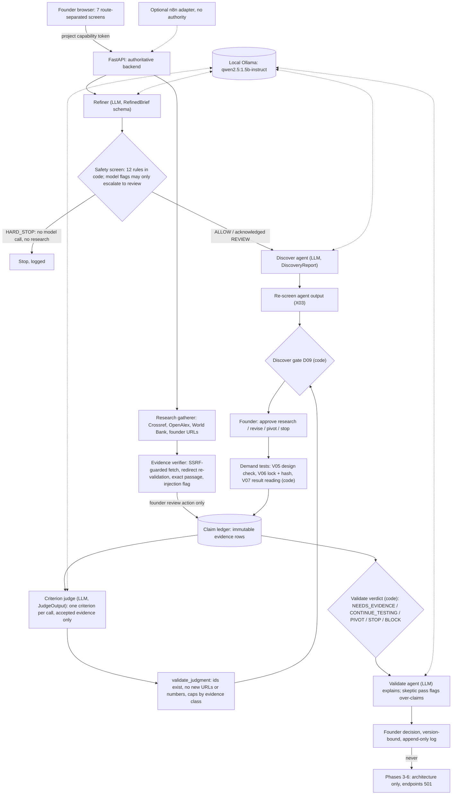

# FounderOS — six-phase reference architecture (hackathon requirement)

**Implementation status (v0.7):** see the diagram below; criteria and safety rules are versioned policy files. Earlier text: Phase 1 **Discover** and Phase 2 **Validate** are active backend workflows using independent calls to a live open-weight local LLM, with a deterministic backend safety screen and a deterministic evidence-based verdict (the LLM explains but never decides). Phases 3–6 are **DESIGN ONLY**, not implemented as working products. Local n8n is optional visual orchestration and does not own the trust boundary.

## 1. Components and trust boundaries



Each role is an isolated function with a typed contract: `llm.REFINE_SYSTEM`/`RefinedBrief`, `safety.screen`, `llm.DISCOVER_SYSTEM`/`DiscoveryReport`, `research.crossref|openalex|worldbank` (gatherer), `research.safe_fetch` + `research.excerpt_in` (verifier), `main.insert_evidence` (ledger), `llm.JUDGE_SYSTEM`/`JudgeOutput` + `criteria.validate_judgment` (judge), `criteria.evaluate_discover` and `decision.evaluate_validation` (deterministic gates). Policy lives in `backend/policy/criteria.yaml` and `backend/policy/safety_rules.yaml`.

**Trust boundaries:**
- User text and web page content are **untrusted data**, not system-level instructions.
- Ollama returns **untrusted suggestions** checked against Pydantic schemas; only deterministic Python code computes gate recommendations and writes transitions.
- The founder controls progression through a per-project bearer token. Tokens are hashed in SQLite; the token is returned only at project creation and must be protected in the browser.
- External side effects (email, posting, purchasing, signing) are **not implemented** and all such attempts are blocked and audited.
- The Python app is authoritative. Optional n8n calls only the same authenticated endpoints; it cannot override checks.

## 2. The six phases, exactly as shown in the presentation

| Phase | Inputs | Agent / tools and responsibility | Deliverable | Exit gate and fail behavior | Status |
|---|---|---|---|---|---|
| 1. **Discover** | Founder brief, skills, budget, time, market, values | Refiner normalizes; Discovery Agent proposes early adopters, hypotheses, and cheap tests | Versioned DiscoveryReport | Required fields + founder approval; revise or stop on missing content | **LIVE** |
| 2. **Validate** | Approved DiscoveryReport + evidence ledger | Validate Agent reviews sources, demand experiments, competitors, risks | ValidationReport + evidence-based recommendation | Preset thresholds; founder reviews; NEEDS_EVIDENCE / STOP / revision possible | **LIVE** |
| 3. **Build** | Approved validation, scope, budget and skills | Future Product Planner, Builder and QA Agents; sandbox codegen + static analysis + tests | Repo/working app with test results | Automated tests pass + founder approval before any external commit/release | **DESIGN ONLY** |
| 4. **Commercial setup** | Working tested product, market positioning | Future Pricing Agent, Policy Drafting Agent; no payment collection | Price hypotheses, policies and terms drafts | Require source-labeled market pricing assumptions and founder review | **DESIGN ONLY** |
| 5. **Launch** | Approved commercial package, tested product | Future Launch Planner, Copy Reviewer, Channel Agent | Approved marketing drafts and proposed campaigns | Explicit separate founder permission **before publishing or sending** | **DESIGN ONLY** |
| 6. **Operate & learn** | Actual opted-in usage, support feedback | Future Support Triage and Analytics Agents | Real metrics, support drafts, improvement backlog | Policy checks + founder review; repeat/pivot/stop possible | **DESIGN ONLY** |

Each phase ends with a gate as shown in organizers' slides. Gate outcomes: **continue, repeat, pivot backward, or stop**. The generic design can check founder approval, preset evidence thresholds, or tests; our conservative MVP additionally requires founder approval at *both implemented phase boundaries*. Approval never supersedes safety policies.

## 3. Executable state machine (two live phases)

```
NEW ──refine──> BRIEF_VERSIONED
  └──── clarify → NEW_BRIEF_VERSION
BRIEF_VERSIONED ──run──> DISCOVER/PENDING_APPROVAL
  ├── founder APPROVE → DISCOVER/APPROVED
  │                      └──run──> VALIDATE/PENDING_APPROVAL
  ├── REVISE → DISCOVER/REVISE_REQUESTED → re-run creates NEW run version
  ├── PIVOT  → DISCOVER/PIVOT_REQUESTED → revise brief & re-run
  └── STOP   → PROJECT/STOPPED
VALIDATE/PENDING_APPROVAL
  ├── founder APPROVE → VALIDATE/APPROVED (no outbound authorization)
  ├── REVISE → new validation run (fresh evidence snapshot)
  ├── PIVOT  → invalidate prior Discover approval → revise brief → new Discover run
  └── STOP   → PROJECT/STOPPED
```

### Explicitly enforced conditions

- Validate cannot run until the **latest Discover run, on the current brief version,** is founder-approved. Discovery cannot run on a BLOCKED brief or an unacknowledged REVIEW_REQUIRED brief.
- Every decision is bound to run id + report hash + brief version + safety status + the experiment versions at decision time, and is written to an append-only `decisions` table (SQLite triggers forbid UPDATE/DELETE). New brief versions, new evidence, new experiment versions/results and pivots set dependent runs to `INVALIDATED` with a reason.
- Duplicate and stale decisions cannot be accepted; the decision references an exact phase run ID and uses a SQLite write lock.
- A model cannot approve; only an authenticated HTTP request with the project capability token can.
- If the founder approves against a gate caution, they must separately acknowledge risk; the ledger's source statuses do not change.
- Source updates are locked while validation is pending or approved; change evidence after requesting revision, then re-run validation against a new snapshot.
- Founder revision feedback is given to the agent on the next run and a new run version is created. Old reports are never silently overwritten. Pivot from Validation reopens Discover, requiring fresh upstream approval before Validation can run again.
- Absent support is **NEEDS_EVIDENCE**, never proof of failure. Source excerpts (any number) can only corroborate background; they never establish demand. **STOP/PIVOT** require a critical, founder-pre-registered experiment whose reported result fails its own frozen criterion (`backend/app/decision.py`). Safety BLOCK (`backend/app/safety.py`) overrides everything. Full policy: `docs/business-decision-methodology.md`.
- Missing significant founder fields lead to a REVISE suggestion in discovery, never fabricated completion.

## 4. Evidence lifecycle and limitations

Four evidence classes (`SECONDARY_BACKGROUND`, `CUSTOMER_STATEMENT`, `CUSTOMER_BEHAVIOR`, `PRE_REGISTERED_EXPERIMENT_RESULT`), each with provenance (`url_status`, `excerpt_status`, `relevance`, `independence`, method/sample/dates/consent, dedupe, injection flag). Only the two strongest classes count toward **demand**; secondary sources are context only; excerpt match ≠ truth. Experiments are drafted → locked (criteria hash + `locked_at`) → results compared with the frozen criteria; edits create new versions and retire old results. Details: `docs/business-decision-methodology.md`.

## 5. Shared memory/data design

- `projects`: founder original input (exact), hashed bearer token, stopped flag.
- `briefs`: append-only versioned refinement, provenance, founder answers.
- `phase_runs`: append-only report versions, immutable gate snapshots plus state updates.
- `safety_assessments`: deterministic screen per brief version, with acknowledgment (research-only).
- `evidence`: typed, immutable rows with multidimensional verification, dedupe and limitations.
- `experiments`: versioned pre-registration (criteria hash, `locked_at`, result link); locked payloads cannot be edited.
- `decisions`: append-only; each row names project, phase, run id/version, brief version, safety status, report hash, input hash, experiment versions, action, scope, reason, time.
- `audit`: timestamped status/decision/change history.

SQLite persists through the `founder_data` Compose named volume. For a multi-user production deployment, replace capability tokens with accounts/roles, migrate to Postgres with row-level access controls, queue long LLM tasks, add CORS/CSRF policies and asynchronous job status. All of these are **future design, not implemented security guarantees**.

## 6. Model / orchestration interface

- Default model is `qwen2.5:1.5b-instruct` via Ollama HTTP `/api/chat`, JSON-Schema constrained format, with one repair attempt and a timeout. No paid APIs or simulated fallback.
- `RefinedBrief`, `DiscoveryReport`, and `ValidationReport` are Pydantic v2 models. Schema validity is necessary but does not establish factual accuracy; every agent output is presented with the appropriate trust warning.
- Python HTTP endpoints are the stable API. The optional n8n JSON adapters call them via a webhook trigger and forward the authenticated request to the backend. Removing n8n does not remove any core feature.
- Every version is durable and can be inspected through `GET /api/projects/{id}` with the correct project token.

## 7. How a future production system would complete the idea-to-product journey

- **Build** creates an actual constrained repo in a sandbox, runs dependency scans, lint and tests, and blocks execution/deployment of unreviewed generated code. Phase ends at a test pass plus founder approval gate.
- **Commercial setup** drafts suggested price bands backed by sources, terms, accessibility and privacy policies, and **does not process money**. All prices explicitly assumptions until tested.
- **Launch** only prepares creative assets and outreach drafts. A separate authorization is requested *for each* real posting/sending action, including audience, exact content and destination, so phase approval alone never grants sending permission.
- **Operate & learn** only ingests real consented events and feedback, tracks evidence-based metrics, suggests repairs/pivots and requests founder approval to change course. Never invent reviews or signed-up users.
- A future global **policy engine** applies source provenance, permission scope, data minimization and immutable audit logic across all six phases.

## 8. Non-goals for this hackathon MVP

Full six-phase automation, guaranteed profitability, customer substitution, live payment collection, paid search APIs, agent actions on third-party accounts, hosted SaaS authentication, production-grade outbound HTTP SSRF guarantees, or fabricated datasets. These are absent by design, not hidden behind mock screens.


## Phases 3–6: criteria and gates (ARCHITECTURE ONLY — not implemented)

Named with the questions from *Criteria Types for the Agent Workflow* (pp.6–8), as that document advises for unbuilt phases (p.11). Machine-readable in `criteria.yaml → architecture_only`. None of these is evaluated; `/phases/{build,commercial_setup,launch,operate_learn}/run` return HTTP 501 and the UI labels them "Architecture only".

| Phase | Gate | Criteria (kind) |
|---|---|---|
| 3 Build (p.6) | Acceptance tests written from the validated value proposition pass, plus founder approval | B01 Scope fit (output check): smallest product delivering the validated value, nothing the founder cannot afford or maintain. B02 Acceptance (threshold): what the product must demonstrably do |
| 4 Commercial setup (pp.6–7) | Founder approval of drafts; **no payments, ever** | C01 Pricing logic (scored, sourced competitor prices or assumption labels), C02 Offer structure (scored), C03 Policy completeness (output check, drafts for human review), C04 Fair dealing (knockout: hidden charges, unclear refunds), C05 Compliance flags (output check: flags for a qualified person, never a legal ruling) |
| 5 Launch (p.7) | Drafts ready to *show* the founder, never ready to publish; each publish/send needs separate action-specific approval | L01 Positioning and message (scored), L02 Channel selection (scored), L03 Content honesty (knockout: income promises, guarantees, invented social proof, speaking as someone else), L04 Content quality (scored), L05 Launch readiness (output check), L06 Launch targets (threshold fixed before launch data) |
| 6 Operate and learn (p.8) | Double down / adjust / pivot back / shut down on real, opt-in results | O01 Metric selection (output check), O02 Support quality (scored, knockout for hand-offs involving money or complaints), O03 Learning validity (evidence standard), O04 Next-step decision (threshold) |

The safety screen must re-run on phase 4 and 5 outputs (PDF p.4: tactics such as pricing tricks or misleading copy). `safety.screen_agent_output` is the hook already used for discovery and validation outputs.
